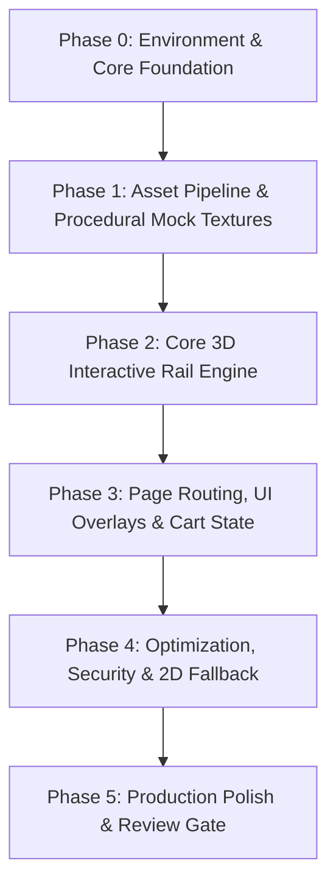

# FITYN — Foundation & Architectural Blueprint

> **Document Version:** 1.0.0  
> **Status:** Review Draft  
> **Brand Mantra:** *"Wear the Calm"*  
> **Target Experience:** Minimalist, gallery-like 3D clothing e-commerce engineered for high performance on everyday mobile devices (~₹10k Android phones on 4G) and desktop screens alike.

---

## 1. Executive Summary & Brand Identity

### 1.1 The Concept
FITYN reimagines streetwear and lifestyle apparel shopping by blending high-fashion digital editorial aesthetics with a tactile 3D experience. Instead of static grids or sluggish 3D model viewers, FITYN is anchored around **one signature interactive hero element**: an ultra-smooth, interactive clothing rail where garments hang, sway subtly in the breeze, flip front-to-back, and shift colourways seamlessly.

### 1.2 Core Pillars
1. **Gallery-Level Minimalism:** Abundant negative space, deliberate typography, neutral backgrounds, zero visual clutter.
2. **Tactile Digital Interaction:** Browsing feels like thumbing through a curated rack at a flagship boutique.
3. **Accessible Performance:** Ultra-lightweight 3D architecture engineered to achieve **≥30 fps on ₹10k Android devices** and locked 60 fps on desktops without draining battery or burning data.
4. **Extensible Commerce Architecture:** Decoupled frontend interface (`CommerceProvider`) designed for rapid mock prototyping today and turnkey backend connection (Shopify / Medusa / Razorpay) tomorrow.

---

## 2. Design System & Visual Language

### 2.1 Colour Tokens & Usage Matrix
The palette is calibrated for calm elegance with high contrast readability.

| Token | Hex Value | Primary Application | Accessibility & Rules |
|---|---|---|---|
| `--offwhite` | `#FFF2B4` | Marquee text, button labels on dark surfaces, badges | **NEVER** use on light backgrounds (`--bg` / `--white`). Minimum 5.4:1 contrast on olive. |
| `--olive` | `#486C2F` | Marquee bar, primary CTA buttons, active state accents | High contrast on `--white` (≈ 6:1). Primary brand accent. |
| `--black` | `#0A0A0A` | Headings, body text on light backgrounds, toggle active pill | Deep, sharp contrast (≈ 18:1 against `--offwhite`). |
| `--bg` | `#F3F3F0` | Main canvas background, page base | Warm, gallery-neutral soft gray-white. |
| `--bg-2` | `#E9E9E4` | Product cards, secondary panels, collection tiles | Subtle separation without harsh lines. |
| `--line` | `#D4D4CE` | Clean borders, thin dividers, clothing rail silhouette | Delicate structural framing. |
| `--white` | `#FFFFFF` | Input fields, active highlight surfaces | Pure highlight. |

### 2.2 Typography Hierarchy
- **Primary Display Font — Anton (Google Font, self-hosted via `next/font`):**
  - Use: Brand wordmark, product titles, section headings, primary button labels, marquee ticker.
  - Characteristics: Bold, condensed uppercase, tracking `0.02em`.
  - Scale: H1 `clamp(2.5rem, 8vw, 6rem)`, H2 `clamp(1.75rem, 4vw, 3rem)`.
- **Flourish Accent Font — Yellowtail (Google Font, self-hosted):**
  - Use: Subtle taglines, editorial script flourish, small hero badges.
  - Rule: Strictly reserved for single-phrase accents; never used for body or UI controls.
- **Functional Body Font — System Sans Stack (`Inter`, `-apple-system`, `sans-serif`):**
  - Use: Paragraphs, descriptions, specs, prices, form inputs, cart & checkout labels.
  - Scale: Body `16px` (`1rem`), caption `12px` uppercase (`0.75rem`, tracking `0.05em`).

### 2.3 Micro-Animations & Interaction Principles
- **Respect Motion Preferences:** Full compliance with `prefers-reduced-motion` (instant transitions, zero wind sway, static rail).
- **Physics-Inspired Easing:** All UI transitions use natural momentum curves (`power2.inOut`, `power3.out`).
- **Touch Ergonomics:** Minimum 44×44px interactive tap zones, bottom-reachable mobile controls, thumb-friendly horizontal swipes.

---

## 3. High-Performance 3D Architecture

### 3.1 The Textured Photo-Plane Paradigm
Traditional 3D e-commerce struggles on mobile because dense 3D meshes (50k+ polygons with heavy PBR materials) choke mid-range mobile GPUs. FITYN solves this fundamentally:
- **Zero Heavy Meshes:** Garments are rendered as **double-sided textured planar quads** cut with precise alpha masks.
- **Memory Footprint:** Each garment quad requires only 4 vertices and 2 triangles. The entire 7-garment rail costs fewer than 50 triangles total.
- **GPU-Friendly Textures:** WebP and KTX2/Basis GPU compression (1024px mobile, 2048px desktop).

### 3.2 Shaders & Motion Mechanics
1. **Vertex Shader Wind Sway:**
   - Subtle wave oscillation ($y, z$ displacement) modulated by distance from the hanger clamp point ($y = 1.0$ is pinned; hem at $y = 0.0$ sways with amplitude $\pm 1.5^\circ$).
2. **Mip-Bias Bokeh / Depth of Field:**
   - Inactive background garments are blurred using hardware-native texture **mip-bias** in the fragment shader. This delivers a rich photographic bokeh at near-zero GPU cost, eliminating expensive full-screen post-processing passes.
3. **Noisy Colourway Wipe:**
   - Transitioning between garment colours executes a bottom-to-top fragment shader wipe driven by a procedural Perlin noise threshold, giving the feel of fabric re-dyeing in real time.
4. **Front / Back Flip:**
   - 180° Y-axis rotation with dynamic texture swapping to display back graphics with zero texture bleed.
5. **Damped Pendulum Hang-Tags:**
   - Real-time tag sway calculated via spring-damper equations in `useFrame` without needing a multi-megabyte physics engine (e.g., Cannon or Rapier).

### 3.3 Dynamic Quality Tiers
| Tier | Device Profile | Target Frame Rate | DPR Cap | Features Active |
|---|---|---|---|---|
| **High** | Desktop, discrete GPU, M-series Macs | 60 fps | 2.0 | Wind shader, hang tags, ambient occlusion shadows, smooth mip bokeh |
| **Medium** | Mid-range smartphones (~₹10k Android, older iPhones) | 30–60 fps | 1.25 | Wind shader, hang tags, texture mip bokeh, textures capped at 1024px |
| **Low / Fallback** | Low-end mobile, WebGL disabled, Save-Data mode | Native UI | 1.0 | **2D CSS Transform Rail** (interactive carousel using identical layout and styling) |

- **Live Adaptation:** Built-in `PerformanceMonitor` dynamically drops DPR or suspends ambient motion if frame drops occur, ensuring the interface never stutters.

---

## 4. Application Architecture & Tech Stack

```
                          ┌─────────────────────────────────────┐
                          │         Next.js App Router          │
                          │   (SSR / Metadata / SEO / Fonts)    │
                          └──────────────────┬──────────────────┘
                                             │
                      ┌──────────────────────┴──────────────────────┐
                      ▼                                             ▼
       ┌─────────────────────────────┐               ┌─────────────────────────────┐
       │     Persistent 3D Canvas    │               │        HTML / DOM UI        │
       │  (Three.js / R3F / Drei)    │               │ (Tailwind CSS / GSAP / A11y)│
       ├─────────────────────────────┤               ├─────────────────────────────┤
       │ • 3D Clothing Rail          │               │ • Navigation Header         │
       │ • Garment Planes & Shaders  │   Zustand     │ • Product Specs & Controls  │
       │ • Wind & Physics Simulation │◄─────────────►│ • Cart Drawer (Zustand)     │
       │ • Camera Director           │   Stores      │ • Checkout Wizard (Zod)     │
       │ • Fallback 2D Render Engine │               │ • Marquee Ticker            │
       └─────────────────────────────┘               └─────────────────────────────┘
                                                             │
                                                             ▼
                                             ┌─────────────────────────────┐
                                             │   CommerceProvider (API)    │
                                             ├─────────────────────────────┤
                                             │ • Mock Catalog (v1 Launch)  │
                                             │ • Medusa / Shopify (Future) │
                                             │ • Razorpay / Stripe (Future)│
                                             └─────────────────────────────┘
```

### 4.1 Core Technologies
- **Framework:** Next.js 15+ (App Router) with TypeScript (Strict Mode).
- **Styling:** Tailwind CSS with CSS custom properties for tokens.
- **3D Pipeline:** Three.js, React Three Fiber (R3F), `@react-three/drei`.
- **Motion & Scroll:** GSAP (orchestrated timelines) + Lenis (smooth virtual scrolling).
- **State Management:** Zustand (atomic stores: `useCartStore`, `useSceneStore`, `useQualityStore`).
- **Validation:** Zod (form inputs, checkout payload validation, schema validation).
- **Typography Engine:** `next/font/google` (zero layout shift, preloaded local font assets).

### 4.2 Single Persistent Canvas Architecture
The 3D `<Canvas>` is hosted once in the root layout (`app/layout.tsx`). As the user navigates between `/` (Home), `/product/[slug]`, and `/collections`, the canvas is **never unmounted or recreated**. 
- Camera transitions, garment focus, and zoom levels are driven by route-aware state (`useSceneStore`).
- Results in instant, fluid page transitions with zero canvas re-initialization lag.

---

## 5. Information Architecture & Routes

| Route | View Name | Key Components & Responsibilities |
|---|---|---|
| `/` | **Home / Signature Rail** | Hero rail (7 garments), brand wordmark, interactive sway, caption, "SEE AVAILABILITY" CTA, bottom olive marquee. |
| `/product/[slug]` | **Product Showcase** | Focused 3D garment, background blur, FRONT/BACK toggle, colour swatches, size picker (S/M/L/XL), "Add to Cart" button, specs. |
| `/collections` | **Collections Index** | Curated collections overview, editorial lookbook cards with hover lift effect. |
| `/collections/[slug]` | **Collection Detail** | Filtered rail or grid for specific capsule drops (e.g., "Monochrome Essentials"). |
| `/cart` | **Cart Drawer / Page** | Persistent drawer + dedicated page, line items, quantity increment/decrement, subtotal, promo code slot, checkout CTA. |
| `/checkout` | **Checkout Wizard** | Clean 3-step checkout: 1. Contact Info → 2. Shipping Address → 3. Payment Review (Mock v1 / Gateway v2). |
| `/checkout/success` | **Order Confirmation** | Order reference number, summary breakdown, estimated delivery timeline, return to shopping CTA. |
| `/404` | **Not Found** | Minimalist branded 404 with instant route back to the rail. |

---

## 6. Commerce Data Model & Interface Contract

To ensure 100% decoupling between the visual experience and future backend solutions, all product and cart operations interface through a typed `CommerceProvider`.

### 6.1 TypeScript Data Schemas
```typescript
export interface Product {
  id: string;
  slug: string;
  name: string;
  subtitle: string;
  price: number; // in INR paise (e.g., 299900 = ₹2,999.00)
  currency: 'INR';
  description: string;
  details: string[];
  collectionIds: string[];
  variants: ProductVariant[];
}

export interface ProductVariant {
  id: string;
  colourName: string;
  colourHex: string;
  frontTexture: string; // URL / asset path
  backTexture: string;  // URL / asset path
  sizes: Array<{
    size: 'XS' | 'S' | 'M' | 'L' | 'XL' | 'XXL';
    stock: number;
  }>;
}

export interface CartItem {
  productId: string;
  variantId: string;
  size: string;
  quantity: number;
  unitPrice: number;
  productName: string;
  colourName: string;
  thumbnail: string;
}

export interface Order {
  id: string;
  orderNumber: string;
  createdAt: string;
  items: CartItem[];
  subtotal: number;
  shipping: number;
  total: number;
  customer: {
    fullName: string;
    email: string;
    phone: string;
  };
  shippingAddress: {
    street: string;
    city: string;
    state: string;
    postalCode: string;
    country: string;
  };
  status: 'PENDING' | 'CONFIRMED' | 'DISPATCHED';
}
```

### 6.2 Commerce Provider Interface
```typescript
export interface CommerceProvider {
  getProducts(): Promise<Product[]>;
  getProductBySlug(slug: string): Promise<Product | null>;
  getProductsByCollection(collectionSlug: string): Promise<Product[]>;
  createOrder(payload: CheckoutPayload): Promise<Order>;
}
```
*V1 uses an in-memory & localStorage mock provider. Swapping to Medusa, Shopify Storefront API, or a custom Node/Go backend requires zero modifications to UI components.*

---

## 7. Performance Budget & Core Web Vitals Targets

All development must operate strictly within the following performance budget:

| Metric | Target | Enforcement Strategy |
|---|---|---|
| **LCP (Largest Contentful Paint)** | < 2.5s | Server-rendered hero skeleton; critical text paints before 3D loads; prioritized fonts. |
| **INP (Interaction to Next Paint)** | < 200ms | Heavy work offloaded; RAF-throttled pointer listeners; passive event handlers. |
| **CLS (Cumulative Layout Shift)** | < 0.1 | Explicit aspect ratios; reserve 3D canvas dimensions; self-hosted fonts with `next/font`. |
| **Initial JS Bundle** | < 170 KB gzipped | Route-level code splitting; lazy-loading Three.js chunk on demand. |
| **3D Engine Chunk** | < 250 KB gzipped | Tree-shaken Three.js imports; avoid monolithic bundles. |
| **Per-Route CSS** | < 20 KB gzipped | Tailwind CSS purging; zero redundant utility duplication. |
| **Frame Rate** | ≥ 30 fps (mobile) / 60 fps (desktop) | Continuous frameloop only during active motion; pause when tab is inactive. |

---

## 8. Security & Resilience Engineering

1. **Content Security Policy (CSP):**
   - Nonce-based script loading, strict dynamic execution, disallowed `unsafe-eval`.
   - Frames, plugins, and object embeddings disabled (`frame-ancestors 'none'`, `object-src 'none'`).
2. **Client-Side Pricing Defense:**
   - Client cart state records only `productId`, `variantId`, `size`, and `quantity`.
   - Prices and line totals are strictly validated and recomputed server-side during checkout generation.
3. **Form & Data Hardening:**
   - All input forms (checkout, contact) parsed and validated through strict Zod schemas with regex constraints on Indian PIN codes and phone numbers.
   - Zero `dangerouslySetInnerHTML` usage.
4. **Supply Chain Hygiene:**
   - Committed lockfile (`pnpm-lock.yaml`), periodic `pnpm audit`, strictly pinned production dependencies.

---

## 9. Accessibility (a11y) & SEO Architecture

### 9.1 Accessibility Standard (WCAG 2.1 AA)
- **Parallel Semantic Tree:** The WebGL canvas is marked with `aria-hidden="true"`. A parallel, visually hidden HTML list structure reflects every product, variant, and action for screen readers.
- **Keyboard Navigation:** Arrow keys navigate between garments; Space/Enter selects; Esc exits focus view; Tab traverses all interactive elements seamlessly.
- **`aria-live` Region:** Live announcement region notifies assistive technologies whenever the active garment, colourway, or side (Front/Back) changes.
- **High-Contrast Focus Indicators:** 2px high-visibility outline with contrast offset on all active focus targets.

### 9.2 SEO Engine
- Full SSR generation for `/collections` and `/product/[slug]` routes.
- Rich structured schema (`schema.org/Product` and `schema.org/BreadcrumbList`) embedded in JSON-LD.
- Dynamic OpenGraph and Twitter card generation for shared product drops.

---

## 10. Execution Roadmap & Phase Breakdown



### Phase 0: Project Scaffolding & Design Foundation
- Initialize Next.js App Router with TypeScript, Tailwind CSS, ESLint, Prettier.
- Configure color token variables, Anton and Yellowtail fonts, and base responsive reset.
- Set up global state stores (Zustand: scene, cart, quality).

### Phase 1: Asset Pipeline & Mock Garment Generation
- Create procedural SVG / WebP generator for mock garments (tank top, oversized tee, hoodie, bomber jacket, cap) with dual colourways and back graphics.
- Prepare hang-tag, rail, and ground shadow textures.

### Phase 2: Core 3D Interactive Rail Engine
- Implement persistent root `<Canvas>` with route-synced camera controller.
- Construct the 7-garment rail component with custom wind-sway vertex shader.
- Implement camera focus, mip-bias bokeh background blur, front/back flip, and colourway noise wipe shader.
- Implement physics-damped hang-tag pendulum.

### Phase 3: Application UI & Commerce Flows
- Build header, navigation, and persistent animated marquee bar.
- Construct product detail overlay, colour swatches, size selectors, and front/back toggle.
- Build slide-out Cart Drawer and Checkout wizard (Contact → Shipping → Order confirmation).
- Implement `CommerceProvider` with local mock database.

### Phase 4: Device Hardening, Performance & Fallback
- Integrate `detect-gpu` and `PerformanceMonitor` for automatic tier scaling.
- Build 2D CSS-transform fallback rail for devices without WebGL or in Save-Data mode.
- Apply security headers, CSP, input sanitization, and Lighthouse audit validation.

---

## 11. Approval & Review Checklist

- [ ] Architectural approach approved (Persistent Canvas + Textured Planes).
- [ ] Visual system, token palette, and typography locked.
- [ ] Device performance thresholds and fallbacks confirmed.
- [ ] Commerce mock data structure and user flows approved.
- [ ] Ready to proceed to **Phase 0 implementation**.
